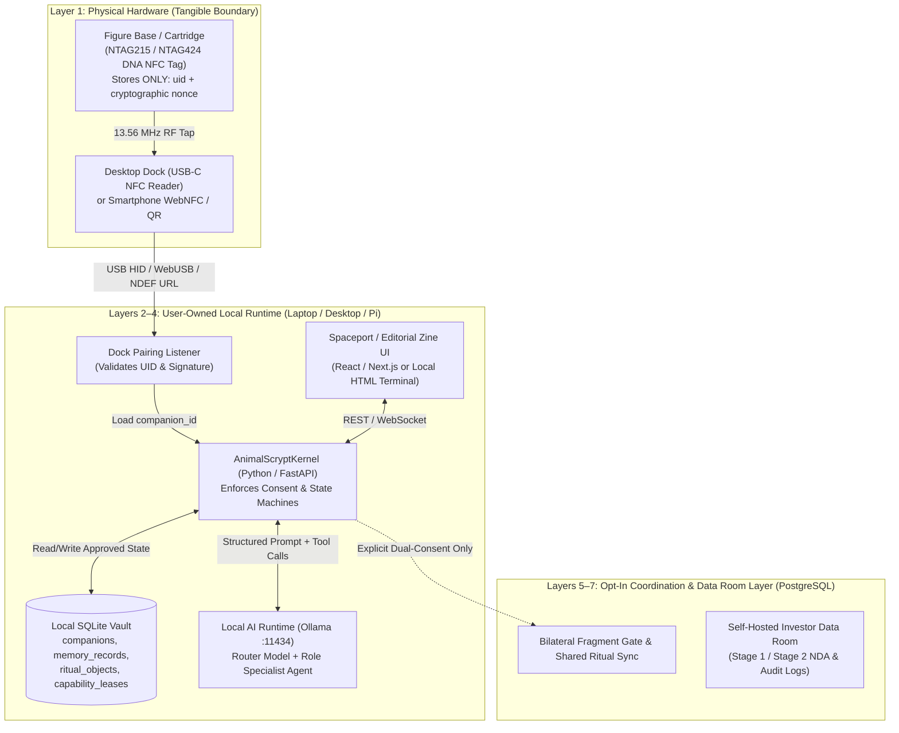

# TECHNICAL ARCHITECTURE — Robotic Discipline

**Scope:** Unified software, database, AI memory, multi-agent orchestration, character authentication, and offline synchronization architecture across **Robotic Discipline** (**MADKEN** + **Animal Scrypt** + **Disciple** + **Space Fort / ORBIT**).

---

## 1. Architectural Principles

1. **Separate Lore, Memory, and Action:** Never allow LLM-generated roleplay dialogue to silently overwrite character lore or personal user facts, and never allow an agent to execute consequential actions without human sign-off.
2. **Local-First, Cloud-Optional:** Personal memories and character state reside in a local SQLite database (`schema.sql`) and exportable JSON bundle (`spacefort.orbit.portable_identity.v0.1`). Cloud sync (PostgreSQL) is used only for opt-in multi-user features (Shared Ritual Objects, Bilateral Fragment Exchanges, Investor Data Room).
3. **Model-Agnostic Portable Identity:** A character's continuity is defined by its structured manifest and approved memory ledger, not by proprietary model weights.
4. **Test-Driven Development (TDD):** Every state transition and permission boundary is backed by automated unit tests (`tests/test_kernel.py`) before UI or hardware integration.

---

## 2. Hardware / Software Boundary Diagram

---

## 3. Core Database Schema (`skeleton/schema.sql`)

The Stage-1 schema is implemented and verified in [`skeleton/schema.sql`](./skeleton/schema.sql) and is compatible with both **SQLite** (local-first) and **PostgreSQL** (cloud/Supabase):

1. **`companions`**:
   * `id` (`TEXT PRIMARY KEY`, e.g., `mk-08-wave`)
   * `owner_id` (`TEXT NOT NULL`)
   * `name` (`TEXT NOT NULL`)
   * `chassis_spec_json` (`TEXT NOT NULL` — JSON encoding `proportion_class`, `translucent_tint`, `optic_accent`, `visible_joints`, `progression_stage`)
   * `authored_lore` (`TEXT NOT NULL` — immutable character biography and faction; never overwritten by conversation)
   * `voice_constraints_json` (`TEXT NOT NULL` — enforces `editorial-zine` tone, `max_sentences: 3`, `clinical_claims_allowed: false`)
   * `created_at` (`TEXT NOT NULL`)
2. **`memory_records`**:
   * `id` (`TEXT PRIMARY KEY`)
   * `companion_id` (`TEXT NOT NULL REFERENCES companions(id) ON DELETE CASCADE`)
   * `category` (`CHECK (category IN ('interest', 'project', 'routine', 'observation'))`)
   * `content` (`TEXT NOT NULL`)
   * `status` (`CHECK (status IN ('PROPOSED', 'APPROVED', 'DELETED'))`)
   * `visibility` (`CHECK (visibility IN ('PRIVATE', 'FRAGMENT_CANDIDATE'))`)
   * `created_at`, `approved_at` (`TEXT`)
3. **`fragment_exchanges`**:
   * `id` (`TEXT PRIMARY KEY`)
   * `memory_id` (`TEXT NOT NULL REFERENCES memory_records(id) ON DELETE CASCADE`)
   * `sender_companion_id`, `recipient_companion_id` (`TEXT NOT NULL`)
   * `shared_summary` (`TEXT NOT NULL`)
   * `sender_approved`, `recipient_approved` (`INTEGER NOT NULL DEFAULT 0`)
   * `created_at`, `approved_at`, `revoked_at` (`TEXT`)
4. **`ritual_objects`**:
   * `id` (`TEXT PRIMARY KEY`)
   * `title` (`TEXT NOT NULL`)
   * `participants_json` (`TEXT NOT NULL` — JSON array of `companion_id`s)
   * `state` (`CHECK (state IN ('DORMANT', 'RESONATING', 'CRYSTALLIZED'))`)
   * `vitality_points` (`INTEGER NOT NULL DEFAULT 0`)
   * `continuity_log_json` (`TEXT NOT NULL DEFAULT '[]'`)
   * `updated_at` (`TEXT NOT NULL`)
5. **`capability_leases`**:
   * `id` (`TEXT PRIMARY KEY`)
   * `granter_companion_id` (`TEXT NOT NULL REFERENCES companions(id)`)
   * `grantee_user_id` (`TEXT NOT NULL`)
   * `worker_role` (`CHECK (worker_role IN ('archivist', 'researcher', 'reminder', 'steward_readonly'))`)
   * `scope_description`, `expires_at` (`TEXT NOT NULL`)
   * `revoked` (`INTEGER NOT NULL DEFAULT 0`)

---

## 4. AI Memory & Multi-Agent Orchestration Design

Following the local-first stack outlined in `DUNA_MAdken.pdf` (Pages 1–2) and the strict state boundaries in `Customized Product Spec Prompt.md`:

* **Runtime Inference Layer:**
  * **Local Default:** **Ollama** serving an OpenAI-compatible endpoint on `http://localhost:11434` using a right-sized tool-calling model (e.g., `qwen2.5:7b-instruct` or `llama3.2:3b` fitting within $\le 2/3$ of available unified memory).
  * **Router Pattern:** A lightweight classifier/router inspects the user's intent and active docked character(s):
    * *Single Docked Character:* Routes directly to that character's system prompt (`skeleton/prompts/system_prompt.md`), injecting only `authored_lore` + `APPROVED` memories for that character.
    * *Multi-Figure Dock Council (2–3 Docked Characters):* A thin supervisor pattern (LangGraph or deterministic Python turn-scheduler) assigns sub-tasks by character class (e.g., **Scholar** retrieves reference notes → **Engineer** drafts CAD/repair steps → **Commander** synthesizes the action checklist) and presents unified output on the Spaceport screen.
* **Typed State Tools (The Only Way Agents Touch State):**
  * `propose_memory(companion_id, category, content, visibility)`
  * `propose_fragment_exchange(memory_id, sender_id, recipient_id, shared_summary)`
  * `tend_ritual_object(ritual_id, active_participants, shared_action_note)`
  * `grant_capability_lease(granter_companion_id, grantee_user_id, worker_role, scope_description, duration_minutes)`

---

## 5. Offline Synchronization & Conflict Resolution

* **Local Simulation Advancement (`More_madken_university.pdf` Page 3):** When a character is offline or undocked, no background cloud compute is required. Upon reconnection, a deterministic local event engine computes elapsed time $\Delta t = t_{\text{now}} - t_{\text{last\_docked}}$ and advances non-critical fictional world state (or transitions an inactive `ritual_object` gently to `DORMANT`).
* **Cartridge / Bundle Sync:** When importing a `portable_identity_export.json` bundle from a cartridge or second device, records are merged by primary key (`id`) with monotonic timestamp precedence (`approved_at`, `revoked_at`), where **deletion and revocation always win (`DELETED` / `revoked_at IS NOT NULL` overrides `APPROVED`)**.
