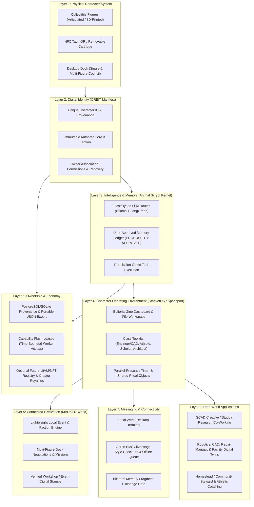

# PRODUCT VISION — Robotic Discipline

**Company:** Robotic Discipline  
**Historical & Component Names:** MADKEN (*Mad Kin*), Animal Scrypt, Disciple, Space Fort  
**Core Hypothesis:** Physical collectible characters can serve as recognizable, tangible interfaces to personal AI workspaces, user-controlled persistent memory, low-pressure human connection, and an interconnected digital civilization.

---

## 1. Three-Audience Explanation of the Unified Product Vision

### A. Explain it to a 10-Year-Old
Imagine owning an action figure on your desk that has its own secret workshop inside your computer. When you place your figure onto its desk pad (the dock), its world pops up on your screen!
* If you put down your **Engineer** character, it opens blueprints and helps you design and build things.
* If you put down your **Athlete** character, it helps you track your workouts and practice sports drills.
* If you put down your **Scholar** or **Storyteller** character, it helps you study, draw, or invent stories.
You can talk to your character, and when you tell it something important—like a project you're making—it asks, *"Want me to remember this?"* You get to press **Yes** or **No**, and you can erase anything whenever you want. Even cooler: if your friend brings their character over and puts it on the dock next to yours, your two characters can team up to help you both finish a project or go on an adventure together!

### B. Explain it to a 24-Year-Old
**What problem does it solve?**  
Today's AI tools feel like sterile, forgetful chat tabs where all your projects blur together, while social apps feel like exhausting performance stages. Meanwhile, millions of young adults buy desk collectibles (like Pop Mart, Funko, or mecha figures) that look great on a shelf but do nothing.

**Why would someone want it and how does it work?**  
Robotic Discipline turns collectible characters into physical keys for specialized, local-first AI workspaces and low-pressure social connection:
1. **Tangible Context Switching:** Tap or dock a physical **MADKEN** figure (starting with a $29–$49 NFC-paired desk figure or $0.50 NFC card) to instantly launch its dedicated **Spaceport / StarNetOS** workspace—configured with the right local/hybrid AI agent, project files, and tools (CAD/engineering, creative study, or athletic coaching).
2. **Inspectable Memory You Actually Own:** Powered by the **Animal Scrypt** memory kernel, the character never silently harvests your chat. It proposes structured memory entries that you explicitly approve, edit, or export as a portable file (`portable_identity_export.json`).
3. **Low-Pressure Parallel Presence:** Instead of awkward group chats, you and a friend or study partner can link your characters around a **Shared Ritual Object**—a digital/physical artifact that levels up when you both complete a 15-minute silent co-working block or approve a two-way memory fragment exchange.
4. **Why buy another character?** Each character class unlocks a distinct functional toolkit, aesthetic workspace, and role in multi-agent "dock councils" (where 2–3 docked figures collaborate on a task).
5. **What can it do today vs. limitations?** Today, the Stage-1 software kernel (SQLite memory ledger, bilateral fragment exchange, ritual object progression, capability flash-leases, and zine UI) runs locally. Physical NFC dock integration and local Ollama/LangGraph model routing are the immediate next prototype steps; full robotic actuation and on-chain marketplaces are deferred to later waves.

### C. Explain it to a Professor
**Theoretical & Technical Framing:**  
Robotic Discipline investigates **Embodied & Tangible Agent Computing** at the intersection of Tangible User Interfaces (TUIs; Ishii & Ullmer, 1997), distributed multi-agent orchestration, and privacy-preserving personal informatics.

1. **Physical-Digital Interaction & Cognitive Scaffolding:** Disembodied conversational UIs impose high cognitive load for context switching and mental model formation. By binding specialized agent profiles (system prompts, tool schemas, retrieval namespaces) to physical tokens (NFC-equipped articulated figures and desktop docks), the system externalizes agent state and role boundaries into physical space.
2. **Tripartite Identity Separation:** Each entity $C_i$ is formally decomposed into three orthogonal state spaces:
   $$\text{State}(C_i) = \langle \mathcal{L}_{\text{immutable}}, \mathcal{M}_{\text{approved}}, \mathcal{P}_{\text{capabilities}} \rangle$$
   where $\mathcal{L}_{\text{immutable}}$ denotes static authored lore and chassis metadata, $\mathcal{M}_{\text{approved}}$ denotes the user-verified episodic memory ledger governed by a deterministic finite-state machine ($\texttt{PROPOSED} \to \texttt{APPROVED} \to \texttt{DELETED}$), and $\mathcal{P}_{\text{capabilities}}$ denotes bounded tool permissions and time-expiring cryptographic leases ($\texttt{capability\_leases}$). This strict separation prevents LLM hallucinations or fictional roleplay from corrupting ground-truth user memory or triggering unauthorized tool calls.
3. **Hybrid / Local-First Inference & Memory Architecture:** Using a small local router model (via Ollama/LangGraph) paired with SQLite/PostgreSQL state checkpoints and vector/structured retrieval, personal memories remain on user-controlled storage. Model weights remain replaceable commodities while the character's identity manifest ($\texttt{spacefort.orbit.portable\_identity}$) is portable across hardware bodies.
4. **Low-Pressure Social Coordination (Parallel Presence):** Drawing on social psychology research into co-action and ambient intimacy, the system replaces high-arousal synchronous chat with **Shared Ritual Objects** and **Bilateral Memory Fragment Exchanges** requiring dual cryptographic/UI sign-off ($\text{Approve}_A \land \text{Approve}_B$), providing an empirically testable intervention for young-adult social isolation without clinical overclaiming.

---

## 2. The 8-Layer Unified Product Architecture

---

## 3. End-to-End User Experience Journey

1. **Discover:** A user discovers Robotic Discipline through a physical figure showcase (e.g., at SCAD), *The Book of Robotic Discipline* essays/worksheets, or a friend's shared ritual invite.
2. **Select Character:** The user selects an archetype aligned with their daily work or creative identity (e.g., **Unit MK-08 WAVE — Engineer/Archivist**, **ORBIT-12 — Scholar/Botanist**, or **Athlete/Coach**).
3. **Register & Pair:** The user taps the physical figure (or starter NFC card) to their phone or USB-C desk dock, claiming the character's unique ID and initializing their local **Portable Identity Manifest**.
4. **Activate Workspace:** Placing the figure on the dock opens its **Spaceport / Zine Terminal** workspace with its authored lore, role tools, and an empty, transparent memory vault.
5. **Interact & Unlock Tools:** The user works alongside the character—talking through a project, organizing files, or starting a 15-minute focus block.
6. **Create Approved Memories:** When the character notices a useful fact (*"Prototyping OpenSCAD shell joints for winter showcase"*), it proposes a memory card. The user clicks **Approve**, **Edit**, or **Discard**.
7. **Complete Shared Activities:** The user pairs their workspace with a collaborator's character to tend a **Shared Ritual Object** during a parallel study/build session, or places a second figure on their dock to run a multi-agent brainstorming session.
8. **Manage Ownership & Privacy:** At any time, the user can inspect every stored memory, revoke a shared fragment, grant a 60-minute **Capability Flash-Lease** of a worker role to a teammate, or export/delete their entire character state as a single JSON bundle.
