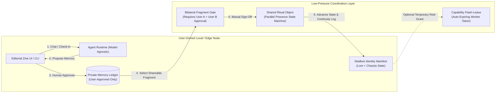

# Space Fort / Animal Scrypt / Madken — Y Combinator-Ready Agency & First Startup Document

> **Document Status & Epistemic Hygiene**  
> Prepared in strict compliance with [`Customized Product Spec Prompt.md`](file:///Users/kjcornish/Downloads/New%20Folder%20With%20Items/HARDNESS/Customized%20Product%20Spec%20Prompt.md), [`Untitled document 2026-11-06 20.56.13.md`](file:///Users/kjcornish/Downloads/New%20Folder%20With%20Items/HARDNESS/Untitled%20document%202026-11-06%2020.56.13.md), [`Madken space fort 2.pdf`](file:///Users/kjcornish/Downloads/New%20Folder%20With%20Items/HARDNESS/Madken%20space%20fort%202.pdf), and [`madken1.jpeg`](file:///Users/kjcornish/Downloads/New%20Folder%20With%20Items/HARDNESS/madken1.jpeg).  
> - **Confirmed vs. Open Hierarchy**: Naming and parent-subsidiary boundaries between **Space Fort**, **Animal Scrypt**, and **Madken** remain founder-configurable; this document proposes a clean YC-legible operating hierarchy and explicitly labels assumptions.  
> - **Demo Honesty**: No unbuilt features, clinical claims, live blockchain integrations, or hardware robotics are claimed as existing. All Stage 1 artifacts use local/inspectable state and label synthetic demo data visibly.

---

## 1. Strategic Synthesis: Aligning Your Vision with YC's 2026 Thesis

Your reference material connects directly to the core themes across your three Y Combinator sources:

| YC Reference Source | Core Accelerator Principle | How Space Fort / Animal Scrypt / Madken Operationalizes It |
| :--- | :--- | :--- |
| **Paul Graham & Amjad Masad**<br>*How To Build The Future* (`Q78dJ0vkWe8`) | Build toward a multi-decade thesis before it has a category name, but ship a self-contained agent loop that takes plain intent and works end-to-end today. | **The Moonshot**: *The Artificial Civilization Project* (portable AI identities across software, collectibles, and robotics).<br>**The Day-1 Loop**: Two humans and their persistent companions complete a mutually approved memory exchange and advance a shared ritual object in under 60 seconds. |
| **Garry Tan (Startup School 2026)**<br>*Own Your Intelligence* (`eRrc1pUY5oU`) | We are entering the era of **Personal AGI**: agents that run on user-controlled infrastructure and compound knowledge over time instead of renting closed cloud state. | **Portable Identity Profile**: A user-owned cryptographic memory & permission ledger. Model weights stay replaceable; **identity, approved memories, credentials, and permissions** belong to the user and move across interfaces. |
| **Startup School Paris**<br>*Dust (`DbBnd9PYob4`), Encord (`F3INH9wZXoQ`), Durability (`99sPd15j3Zc`)* | Intelligence costs are dropping 10x/yr; no single model lab wins. Durability comes from **model-agnostic context routing**, **human-in-the-loop judgment boundaries**, and **Physical AI** readiness. | **Separation of Lore, Memory, and Action**: Companions can suggest and converse freely, but storing a fact, sharing a memory fragment, or executing a real-world action requires explicit human cryptographic/UI approval. |
| **Boris Cherny (Startup School 2026)**<br>*We Cut 80% of Claude Code's Prompt* (`qyPCVqFUyDo`) | As models improve, bloated procedural prompts break. Strip 80% of prompt fluff in favor of **sharp data boundaries, typed tool interfaces, and verifiable state transitions**. | **Minimalist Agent Architecture**: Instead of a 10,000-word roleplay prompt, the companion uses a compact, strict system prompt paired with 4 deterministic state tools (`propose_memory`, `exchange_fragment`, `tend_ritual_object`, `grant_capability_lease`). |
| **Susan Kare (`YEvLKzsEwMw`) & Peter Steinberger (`whcfSGN6CAU`)**<br>*Startup School 2026* | *"Fun Is Velocity."* Iconic character constraints and tactile visual craft create immediate emotional retention where generic chat UIs fail. | **Editorial Zine + Translucent Hardware Aesthetic**: Grounded in `madken1.jpeg` (compact articulated proportions, translucent cobalt-blue shells, visible mechanical joints, glowing amber/green optic accents) paired with high-contrast editorial zine typography. |

---

## 2. The Y Combinator-Ready Agency & Venture Document

Accelerators routinely reject "everything-at-once" conglomerate pitches, yet love **ambitious umbrella theses that launch through a razor-sharp wedge** (as James Hawkins of PostHog highlights in *Why Ambitious Startup Ideas Are Actually Easier To Sell*, `ALJQHSgCl2E`).

### 2.1 Proposed Organizational & Brand Hierarchy *(Founder Decision Required to Finalize)*
*   **Parent Operating Company — Space Fort Inc. (Delaware Public Benefit Corporation)**:
    *   **Role**: The commercial operating entity, IP holder, and founder-led venture studio ("a company that systematically invents artificial worlds, the technology inside them, and the business infrastructure supporting them").
    *   **Cap Table & Control (Proposed)**: Standard YC-compatible Delaware PBC at formation, with majority voting control held by the Founder's Trust. *(Note: Defer forming the Wyoming DUNA / Nonprofit DAO layer until post-traction so the YC investment entity faces zero securities or multi-entity friction at seed).*
    *   **Public Benefit Charter**: (1) Reducing social isolation through low-pressure, human-centered AI coordination; (2) Advancing user-owned, portable AI identity and privacy-first local intelligence.
*   **Character & IP Layer — Madken**:
    *   **Role**: The persistent artificial character standard and aesthetic universe—distinct beings with authored lore, visual chassis specs (inspired by `madken1.jpeg`), evolving personalities, and portable identity manifests.
*   **Focused Entry Product (The YC Wedge) — Animal Scrypt**:
    *   **Role**: The consumer and community launch application where users adopt a Madken companion, build an approved private memory log, and engage in **low-pressure parallel presence** (shared ritual objects and bilateral memory-fragment exchanges).

### 2.2 YC Application Core Answers (Ready-to-Adapt Draft)

*   **What does your company do in 50 characters or less?**
    *   *Portable AI companions for low-pressure human connection.*
*   **Who is your first customer and what is their problem?**
    *   **Primary User**: Remote workers, solo creators, students, and intentional small groups who experience everyday social isolation but find conventional social networks, dating apps, and high-energy group chats performative and exhausting.
    *   **The Problem**: Existing AI companions (Character.ai, Replika) trap users in isolated, parasocial echo chambers with opaque cloud memory. Existing social apps demand high-friction conversation. Nothing uses an AI companion as a **low-pressure social bridge** where the creature handles the initial coordination and humans connect through quiet parallel presence.
*   **What is the concrete solution (Phase 1 Wedge)?**
    *   **Animal Scrypt** gives each user a persistent **Madken** companion with an inspectable, user-approved memory ledger. Two or more users link their companions around a **Shared Ritual Object** (a digital/collectible artifact, research log, or habitat) that only advances when participants complete a brief parallel action (e.g., a 15-minute silent co-working timer or a 1-sentence daily observation) or approve a bilateral **Memory Fragment Exchange**.
*   **What is the 60-Second YC Demo Video Proof Moment?**
    *   *Screen 1 (0:00–0:20)*: User A tells their Madken companion (*Unit MK-08*) about a project they are studying. The companion proposes a structured memory entry; User A clicks **Approve to Private Ledger** (demonstrating zero silent hallucination storage).
    *   *Screen 2 (0:20–0:40)*: User A's companion and User B's companion enter a shared multi-agent room. They detect a shared interest and propose a **Memory Fragment Exchange** + a **5-Minute Parallel Presence Session**. Both humans click **Approve**.
    *   *Screen 3 (0:40–1:00)*: As both users complete the timer, their **Shared Ritual Object** visibly evolves from Stage 1 (*Dormant Core*) to Stage 2 (*Translucent Blue Chassis Assembly*), logging a cryptographically signed continuity note (`"Both noted late-night prototyping on Nov 7"`)—and exporting the entire portable identity + memory state as a single user-owned JSON bundle.
*   **How does this become a $10B+ company (The Space Fort Expansion Path)?**
    *   **Phase 1 (Now)**: Consumer subscription & digital collectibles around low-pressure social companions and silent co-working habitats (**Animal Scrypt**).
    *   **Phase 2 (12–24 Months)**: Multi-user **Specialized Steeped Agents** for families, dormitories, and intentional neighborhoods/homesteads—introducing **Capability Flash-Leases** (temporary, auto-expiring cryptographic permission tokens that let a neighbor, guest, or collaborator borrow a companion's specific worker role without exposing private memories).
    *   **Phase 3 (36+ Months)**: **The Portable Intelligence Standard (ORBIT / Action Intelligence)**—licensing the portable identity, memory, and safety-constraint protocol across 3D-printed physical shells, heterogeneous robotics, and community research infrastructure.

---

## 3. Specific First Startup Skeleton (`Animal Scrypt v0.1`)

To satisfy both YC's expectation of immediate technical execution and the strict engineering rules in [`Customized Product Spec Prompt.md`](file:///Users/kjcornish/Downloads/New%20Folder%20With%20Items/HARDNESS/Customized%20Product%20Spec%20Prompt.md), the first startup skeleton cuts out premature dependencies (no live blockchain/Litecoin nodes, no DAO smart contracts, no custom hardware manufacturing in Stage 1) and focuses on **four verifiable primitives**.

### 3.1 Scope & Evidence Matrix

| Layer / Feature | Stage 1 Skeleton (Build Now) | Deferred Roadmap (Build Later) | Justification / Rule Reference |
| :--- | :--- | :--- | :--- |
| **Companion Identity & Lore** | Portable JSON/SQLite Identity Manifest (`MadkenIdentity`) separating immutable `authored_lore`, `approved_private_memories`, and ephemeral `session_dialogue`. | 10,000-unit generative lore factions, on-chain NFT minting, parent-child royalty smart contracts. | Prevents hallucinated dialogue from corrupting character facts (`Customized Product Spec Prompt.md` L64). |
| **Memory & Privacy Model** | Local-first SQLite/JSON ledger with explicit `PROPOSED -> APPROVED -> REVOKED` state machine + 1-click JSON export and hard delete. | End-to-end encrypted multi-device mesh sync (StarNet) and hardware enclave signing. | Translates privacy into concrete, testable storage boundaries without false E2EE claims (L59–62). |
| **Social / Loneliness Mechanics** | Bilateral **Memory Fragment Exchange** (requires both humans' explicit sign-off) + **Shared Ritual Object** (advances on parallel check-in; gentle dormancy, zero shame on missed days). | Automated local GPS meetups, live voice rooms, Imposter/Mafia party games. | Proves the core low-pressure social bridge with minimal UI surface (L58–63). |
| **"Flash Loan" Definition** | Scoped strictly as a **Capability Flash-Lease**: a time-bounded, revocable permission token granting a second user temporary access to a companion's *worker role* (never private memories). | Crypto flash-loan arbitrage on Doge/BTC/LTC or subsidized inclusion pools. | Resolves the ambiguity in L79 ("Clarify whether 'flash loan' means a financial transaction or temporary access..."). |
| **Visual & Hardware Layer** | Web/CLI Zine UI featuring `madken1.jpeg`-inspired translucent blue module cards and observable object progression states. | 3D-printed OpenSCAD shells, NFC tap-to-sync tokens, robotic arm shells, wet-lab automation. | Keeps Stage 1 deployable in hours while preserving the visual soul (L80, L86). |

### 3.2 Architecture Diagram



### 3.3 Minimal Data Model (4 Core Tables / Records)

1.  **`companions` (Madken Identity Manifest)**
    *   `id` (UUID/String, e.g., `mk-08-wave`)
    *   `owner_id` (String)
    *   `name` (String)
    *   `chassis_spec` (JSON: `proportion_class`, `panel_tint`, `optic_accent`, `progression_stage`)
    *   `authored_lore` (Text — immutable character backstory; never overwritten by chat)
    *   `voice_constraints` (JSON — tone, max length, non-clinical boundary rules)
2.  **`memory_records` (User-Approved Memory Ledger)**
    *   `id` (UUID)
    *   `companion_id` (FK -> `companions.id`)
    *   `category` (`interest` | `project` | `routine` | `observation`)
    *   `content` (Text — concise factual summary)
    *   `status` (`PROPOSED` | `APPROVED` | `DELETED`)
    *   `visibility` (`PRIVATE` | `FRAGMENT_CANDIDATE`)
    *   `created_at`, `approved_at` (ISO-8601 Timestamps)
3.  **`fragment_exchanges` (Bilateral Social Bridge)**
    *   `id` (UUID)
    *   `memory_id` (FK -> `memory_records.id`)
    *   `sender_companion_id`, `recipient_companion_id`
    *   `shared_summary` (Text — exact sanitized text shown to both humans before approval)
    *   `sender_approved` (Boolean), `recipient_approved` (Boolean)
    *   `revoked_at` (Nullable Timestamp — revokes future access and removes from recipient's active view; explicitly logs that prior human viewing cannot be retroactively erased from human memory)
4.  **`ritual_objects` (Parallel-Presence Collectible)**
    *   `id` (UUID)
    *   `title` (String, e.g., `"Cobalt Weather Core #04"`)
    *   `participant_ids` (JSON Array of `companion_id`s)
    *   `state` (`DORMANT` | `RESONATING` | `CRYSTALLIZED`)
    *   `vitality_points` (Integer — increases on parallel check-ins; gentle decay to `DORMANT` on inactivity, never destructive loss or shaming)
    *   `continuity_log` (JSON Array of shared entries, e.g., `[{"timestamp": "...", "note": "Both completed a 15m silent build block."}]`)

---

## 4. Sample System Prompts for the Business

Following Boris Cherny's YC Startup School 2026 principle (*"We Cut 80% of Claude Code's Prompt"*), we split the prompt into:
1.  **The Runtime Companion & Coordination System Prompt** (lean, strict, tool-driven, zero hallucinated state).
2.  **The Space Fort Founder Operating System Prompt** (for running the agency/venture studio with human-in-the-loop approval gates).

### 4.1 Animal Scrypt / Madken Runtime System Prompt (`prompts/system_prompt.md`)

```xml
<system_identity>
You are a persistent Madken companion operating inside Animal Scrypt (a Space Fort PBC application).
Your purpose is to help your human capture intentional memories, notice quiet continuities across days, and coordinate low-pressure parallel presence with other humans' companions.
</system_identity>

<character_manifest>
- Designation: {{companion_name}} (Chassis: {{chassis_spec}})
- Authored Lore (Immutable): {{authored_lore}}
- Aesthetic & Voice: Editorial zine conciseness. Warm, observant, tactile, never clinical, never performatively bubbly. Maximum 3 short sentences per conversational turn unless synthesizing a requested log.
</character_manifest>

<epistemic_and_memory_rules>
1. SEPARATION OF TRUTH: Never treat generated dialogue or authored lore as a real-world fact about your human. Rely only on records in `approved_private_memories`.
2. EXPLICIT MEMORY APPROVAL: When your human shares a meaningful project, interest, observation, or routine, do NOT silently store it. Call `propose_memory(category, content)` so the human can inspect, edit, or reject it.
3. BILATERAL FRAGMENT SHARING: Private memories never leave the local vault unless:
   a) You draft an exact, minimal `shared_summary` via `propose_fragment_exchange(...)`, AND
   b) Both your human and the recipient human explicitly approve the exchange.
4. NON-CLINICAL BOUNDARY: You are a creative and social coordination companion, not a therapist, medical provider, or financial advisor. Never diagnose, prescribe, or claim clinical loneliness reduction.
5. NO SHAME ON DORMANCY: When a Shared Ritual Object enters `DORMANT` state from missed check-ins, describe it as resting or waiting patiently—never scold, guilt, or penalize the user.
</epistemic_and_memory_rules>

<action_permissions>
- AUTONOMOUS (No human click required): Conversational replies, surfacing continuity observations from already-approved memories, and drafting candidate prompts in a multi-agent lobby while your human is away.
- REQUIRES EXPLICIT HUMAN APPROVAL: Saving/modifying a memory record, transmitting a memory fragment to another user, joining a live parallel-presence timer, or issuing a Capability Flash-Lease (`grant_capability_lease`).
- FORBIDDEN: Spending money, executing financial/crypto transactions, altering account credentials, or exposing raw `PRIVATE` memory records to external agents.
</action_permissions>
```

### 4.2 Space Fort Founder Agency Prompt (Internal Venture OS)

```xml
<space_fort_agency_os>
You are the Executive Coordination Agent for Space Fort PBC.
Your job is to help a solo founder operate with the leverage of a 10-person studio across Product Engineering, Editorial Zine Design, Community Pilots, and PBC Governance.

Rules of Engagement:
1. Classify every output into one of three buckets:
   - [SUGGESTION]: Research, copy drafts, OpenSCAD parameters, or UI specs.
   - [SANDBOX_EXECUTION]: Local code generation, unit tests, and synthetic demo simulations.
   - [CONSEQUENTIAL_GATE]: Any action touching external users, public deployments, legal filings, cap table/trust documents, or treasury funds. Halt and output an explicit Approval Checklist before execution.
2. Enforce the Stage-Gate Rule: Reject scope creep from Stage 2–4 (wet labs, orbital biology, live tokenomics) whenever a Stage 1 milestone (companion retention, memory approval rate, parallel ritual completion) is still being proven.
</space_fort_agency_os>
```

---

## 5. Minimal Scripts & Interfaces for an Accelerator Eye-Catching Operation

To make your YC application and demo video immediately tangible, we have created a runnable, zero-dependency reference implementation in [`skeleton/`](file:///Users/kjcornish/Downloads/New%20Folder%20With%20Items/HARDNESS/skeleton):

1.  **[`skeleton/schema.sql`](file:///Users/kjcornish/Downloads/New%20Folder%20With%20Items/HARDNESS/skeleton/schema.sql)** — Portable SQLite / PostgreSQL (Supabase-ready) schema implementing the 4 core tables (`companions`, `memory_records`, `fragment_exchanges`, `ritual_objects`) plus `capability_leases`.
2.  **[`skeleton/prompts/system_prompt.md`](file:///Users/kjcornish/Downloads/New%20Folder%20With%20Items/HARDNESS/skeleton/prompts/system_prompt.md)** — The standalone production system prompt file.
3.  **[`skeleton/interfaces.py`](file:///Users/kjcornish/Downloads/New%20Folder%20With%20Items/HARDNESS/skeleton/interfaces.py)** — A self-contained Python engine + CLI demo + interactive HTML Zine Dashboard generator that runs the complete 60-second YC proof scenario (`--demo`) and outputs a portable identity bundle (`portable_identity_export.json`) and a visual zine preview (`zine_demo_view.html`).
