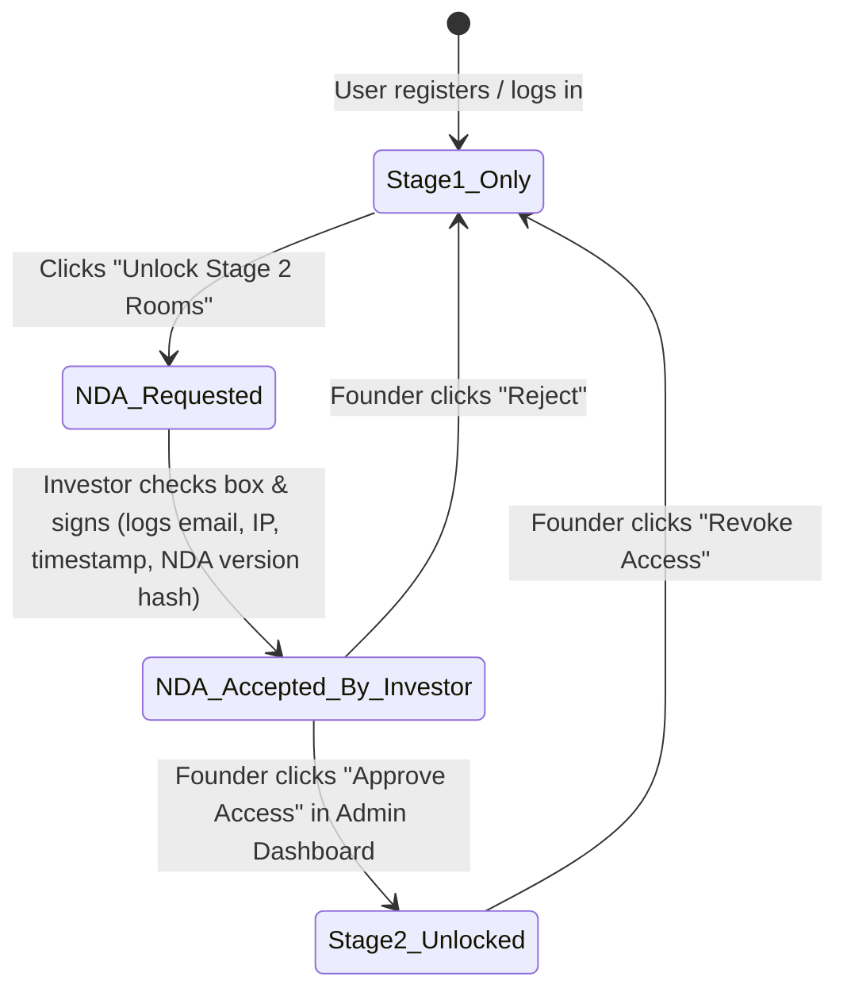

# 23 — Self-Hosted Data Room Product Spec (`/dataroom` Spec)

**Context read:** [`00-context.md`](./00-context.md), [`20-dataroom-checklist.md`](./20-dataroom-checklist.md), [`nda-status.md`](./nda-status.md)  
**Factory Gate:** **STOP FOR APPROVAL BEFORE CODE.** Per Section 12 and Section 21 of the Master Prompt, do not write the application code for this data room until the founder replies approving this spec.

---

## 1. Purpose & Brand
A self-hosted, investor-ready startup data room built for accelerator diligence (SCAD Accelerator, YC, Techstars, a16z Speedrun).
* **White-Label Config (`config/brand.json`):**
  * Company / Product Name: `Animal Scrypt (Robotic Discipline)`
  * Colors: Cream paper (`#EFE6D4`), Ink (`#101419`), Acid Lime (`#D8FF3E`), Hot Blush (`unset` — fallback to `#101419` border until founder sets hex).
  * Links: Pitch Deck URL, 60-Second Demo URL, Custom Domain.

---

## 2. Users, Roles, and Permissions

| Role | Stage 1 Rooms (`Public`) | Stage 2 Rooms (`Sensitive`) | Upload / Edit | Admin & Audit Export |
|---|---|---|---|---|
| **Founder (`admin`)** | Read / Write | Read / Write | Yes (all rooms) | Yes (approves NDAs, exports CSV audit log, edits branding) |
| **Advisor** | Read + Comment | Read + Comment *(only if granted per-user)* | Comment only | No |
| **Partner** | Read | No *(unless granted)* | Upload to invited room only | No |
| **Investor Stage 1** | Read only | **Locked (`403 Forbidden`)** | No | No |
| **Investor Stage 2** | Read only | **Read only *(requires `nda_status = 'APPROVED'`)* ** | No | No |

---

## 3. The Nine Rooms & Stage Gate

* **Stage 1 (Unlocked upon login, `stage2_unlock = false`):**
  1. `Overview` (Executive summary, `00-context.md`, `07-canvas.md`, `08-business-plan.md`)
  2. `Team` (Founder bio, SCAD fabrication & research context)
  3. `Product` (Architecture, 60-second demo, `zine_demo_view.html`)
  4. `Milestones` (7-box MVP checklist, `28-case-study.md`, `29-white-paper.md`)
* **Stage 2 (Locked behind `nda_status = 'APPROVED'` and `stage2_unlock = true`):**
  5. `Financials` (Unit economics, burn model, cohort math `05-pricing.md`, `06-cfo.md`, bank statements)
  6. `Cap Table` (Founder equity ledger, SAFE register)
  7. `Legal` (Incorporation docs, tester consents, templates)
  8. `Tax` (EIN letter, state filings)
  9. `IP` (IP assignment, SCAD clearance, unreleased prompts & royalty code)

---

## 4. NDA State Machine Flow

---

## 5. GDPR, Privacy, Audit Logging & i18n Requirements

* **Cookie Consent:** Essential session cookie (`httpOnly`, `SameSite=Strict`) labeled clearly. Non-essential analytics disabled by default until explicit opt-in banner acceptance.
* **Multilingual UI (`en`, `de`, `fr`):** Navigation labels, NDA flow prompts, cookie banner, and empty states translated in `locales/{en,de,fr}.json`. Document bodies remain in their original language.
* **Account Data Export & Delete:** Every non-admin user has a one-click `Export My Account Data (JSON)` and `Delete My Account` button in Settings. (Note: Audit log retains anonymized document-view timestamps for security compliance—flagged as a **question for counsel** regarding GDPR Art. 6(1)(f) legitimate interest vs. erasure).
* **Audit Log (`audit_logs` table):** Every document view or download records `user_id`, `email`, `role`, `document_id`, `room_slug`, `action` (`VIEW` | `DOWNLOAD` | `NDA_SIGN` | `AI_QUERY`), `ip_address`, and `created_at` (UTC), with one-click CSV export for the founder.

---

## 6. AI Chat with Hard NDA Lock

* **Corpus Separation:** Documents are tagged `tier: 'STAGE_1'` or `tier: 'STAGE_2'` in PostgreSQL.
* **Query Enforcement:** Before building the prompt for the data room AI assistant, the backend checks `user.nda_status === 'APPROVED'` in PostgreSQL (never trusting client-side flags):
  * If `false`: Retrieval queries **only** `WHERE tier = 'STAGE_1'`, and the system prompt injects a hard refusal rule: *"This viewer has Stage 1 access only. Refuse any question about cap table, bank/tax records, signed contracts, private customer names, or unreleased IP, and direct them to request Stage 2 NDA approval."*
  * If `true`: Retrieval includes Stage 1 + Stage 2 documents and logs the query in `audit_logs`.

---

## 7. Target Stack & Build Order (Once Approved)

* **Stack:** Next.js (App Router, TypeScript), PostgreSQL (Prisma or `pg`), `bcrypt`/`argon2` email+password auth, local/S3 signed document URLs, `docker-compose.yml` (Postgres + web app) for one-command local run, plus Vercel deployment config.
* **Non-Goals for v1:** DocuSign/HelloSign paid API integrations, automated cap-table dilution calculators, Stripe billing, or native iOS/Android apps.
* **8-Step TDD Build Order:**
  1. PostgreSQL schema + Auth & Roles (`admin`, `advisor`, `partner`, `investor_s1`, `investor_s2`) + failing/passing auth tests.
  2. Nine Rooms + signed-URL document upload/download + room permission middleware tests.
  3. NDA state machine (`NONE -> REQUESTED -> SIGNED -> APPROVED / REJECTED`) + Stage 2 unlock tests.
  4. Immutable Audit Log middleware + Founder CSV export + tests.
  5. White-label Branding config (`#EFE6D4` cream, `#D8FF3E` lime, logo, deck link).
  6. GDPR Cookie Banner + `en`/`de`/`fr` i18n switcher + user JSON export/delete.
  7. Stage-locked AI Chat endpoint + test proving an un-NDA'd user cannot leak Stage 2 text.
  8. `docker-compose.yml`, `LOCAL.md`, and Vercel deployment guide.
