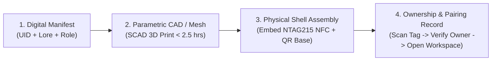

# 29 — Preprint-Style Methods Note (`/paper`)

**Status:** **Preprint-Style Methods Note (Not Peer-Reviewed).** Prepared after [`28-case-study.md`](./28-case-study.md) to document our memory schema, physical embodiment pipeline, parent-child royalty rule, and experimental protocol before human-subject trials.  
**Title:** **Identity, Embodiment, and Royalties for a Persistent Artificial Animal**  
**Author:** Kendren "KJ" Cornish — Robotic Discipline (Savannah, Georgia)  
**Date:** November 8, 2026

---

## 1. Abstract

Conversational language model applications typically treat an agent as a transient session whose context either resets between visits or accumulates unverified dialogue in an opaque cloud store. Conversely, physical character collectibles—generating over `$5.1 billion` annually at Pop Mart (https://www.popmart.com) and `EUR 630 million` at Tonies SE (https://ir.tonies.com)—lack persistent episodic memory or functional utility. This methods note specifies the architecture of **Animal Scrypt** (developed under **Robotic Discipline**), a socio-technical system that binds three components: (1) a continuant software agent governed by an explicit human-approved memory ledger (`PROPOSED -> APPROVED -> DELETED`), (2) a 3D-printed physical shell coupled via a passive QR/NFC identifier, and (3) a single-event parent-child creator royalty ledger. We report findings from our initial local kernel verification (`28-case-study.md`), analyze four threats to validity (including identity drift and founder-as-only-user bias), and define a falsifiable 7-day recall protocol for three consenting adult participants.

---

## 2. What We Mean by a Continuant Agent

In standard LLM interfaces, the user interacts with a stateless function $f_{\theta}(x_{1:t})$ parameterized by model weights $\theta$ over a sliding token window $x_{1:t}$. When the window overflows or the model provider updates $\theta$ (a frequent complaint among Replika Pro and Character.ai subscribers; https://www.reddit.com/r/CharacterAI/, https://replika.com), the perceived individual disappears.

We define an Animal Scrypt creature not as a session or a set of model weights, but as a **continuant tuple** $A_i(t)$ at time $t$:

$$A_i(t) = \langle \text{UID}_i, \mathcal{L}_i, \mathcal{M}_i^{\text{approved}}(t), \mathcal{R}_i, \text{Shell}_i \rangle$$

where:
* $\text{UID}_i$ is a persistent identifier linked to physical tag $\text{Shell}_i$.
* $\mathcal{L}_i$ is the **immutable authored biography and voice constraint set**, which conversation can never overwrite.
* $\mathcal{M}_i^{\text{approved}}(t)$ is the **user-approved memory store** at time $t$.
* $\mathcal{R}_i \in \{\text{engineer}, \text{artist}, \text{musician}, \text{researcher}\}$ is the creature's active worker role.

Because $A_i(t)$ is serialized in a model-agnostic SQLite/JSON bundle (`spacefort.orbit.portable_identity.v0.1`), the underlying inference model $\theta$ can be swapped without destroying the individual.

---

## 3. Memory Schema (What Is Stored, What Is Forgotten, Who Can Export It)

Implemented in [`skeleton/schema.sql`](../skeleton/schema.sql) and [`skeleton/interfaces.py`](../skeleton/interfaces.py), the memory architecture enforces three rules:

1. **Zero Silent Storage (`PROPOSED -> APPROVED`):** When a user converses with creature $A_i$, candidate facts (`interest`, `project`, `routine`, `observation`) are written to `memory_records` with `status = 'PROPOSED'`. Proposed records are excluded from future prompt retrieval until the human owner triggers `review_memory(id, approve=True)`, transitioning the row to `APPROVED` with an ISO-8601 `approved_at` timestamp.
2. **Hard Forgetting (`DELETED` and Revocation):** If the owner rejects a proposed fact or deletes an existing memory, its status transitions to `DELETED` (or is purged via `ON DELETE CASCADE`) and is immediately excluded from all retrieval queries and exports. For bilateral memory exchanges (`fragment_exchanges`), setting `revoked_at` removes the shared summary from active views while logging the epistemic boundary that prior human reading cannot be retroactively erased from human biological memory.
3. **User-Owned Export:** Calling `export_portable_bundle(companion_id)` outputs a deterministic JSON file containing $\mathcal{L}_i$ and all `APPROVED` records, allowing the owner to inspect, back up, or migrate their animal offline.

---

## 4. Embodiment Pipeline (Digital State $\to$ Print File $\to$ Object $\to$ Record)

Rather than embedding high-failure lithium batteries, servo motors, and 2.4GHz Wi-Fi radios inside the first-generation figure—components responsible for recurring user failures in `$249–$369` desktop robots such as Living.AI's EMO and AIBI (https://www.trustpilot.com/review/living.ai)—our v1 embodiment pipeline decouples physical presence from compute:

1. **Digital State:** A creature record `id` is generated in `companions`.
2. **Print File:** A compact shell geometry (target print time $< 2.5$ hours, material cost `~$5.50` `assumption:`) is sliced for PLA/resin fabrication at SCAD.
3. **Physical Object:** A passive 13.56 MHz NTAG215 NFC sticker and laser/printed QR fallback code are recessed into the shell's base.
4. **Ownership Record:** Scanning the tag resolves the browser workspace URL for `id`, verifying the owner record and loading $\mathcal{M}_i^{\text{approved}}(t)$.

---

## 5. Royalty Graph (Parent, Child, Triggering Event, and Refusals)

When an owner curates a set of domain-specific approved memories and prompt rules inside a **Parent Animal** $A_P$ (for example, 20 verified rules for 3D-printer joint tolerances), that non-private skill template can be forked to instantiate a **Child Animal** $A_C$ for a second user:

* **Graph Structure:** Directed acyclic lineage edge $e = (A_P \to A_C)$ recorded in the ledger (simulated in SQLite for MVP done-condition #6; designed for Litecoin/LitVM settlement post-validation).
* **Privacy Isolation During Forking:** Any memory record with `visibility = 'PRIVATE'` is stripped prior to template export; only non-personal worker instructions transfer to $A_C$.
* **Single Triggering Event (V1):** A royalty allocation ($r = 0.20$ of net mint/shell price; `05-pricing.md`) is credited to the owner of $A_P$ **solely when a buyer completes a paid mint of $A_C$**.
* **Explicit Refusals:** To prevent wash-trading, runaway compute deficits, and multi-level marketing dynamics, the v1 rule refuses payouts on: (a) unpaid test forks, (b) multi-hop grandchildren ($A_P \to A_C \to A_{GC}$), and (c) monthly compute subscriptions (`$9/mo`).

---

## 6. Threats to Validity

Any evaluation of Animal Scrypt at this stage must account for four threats to validity:

1. **Identity Drift:** Even with immutable `authored_lore` and `APPROVED` memory cards, underlying LLM updates or conflicting user-approved facts over months can cause the creature's conversational tone to drift.
2. **Print-to-Persona Mismatch:** A static 3D-printed shell may fail to convey the creature's evolving digital worker state if the user rarely looks at the physical object after scanning it once.
3. **Founder-as-Only-User Bias:** As of November 8, 2026 (`28-case-study.md`), the kernel has been executed only by the founder using synthetic demo data (`synthetic_demo_data: true`). Zero independent retention claims can be made prior to external testing.
4. **Parallel Domain Separation (Equine Sensing Thread):** While the founder conducts an adjacent SCADpro research thread on longitudinal AI sensing for horses (gait, vocalization, telehealth), empirical findings from biological animal sensing do not validate consumer retention for artificial collectibles and are kept strictly separate (`00-context.md`).

---

## 7. Methods Note from Build Case 01 (`28-case-study.md`)

In Build Case 01 (November 8, 2026), code inspection and execution of `skeleton/interfaces.py` demonstrated that relational constraints in `schema.sql` successfully prevent unapproved chat proposals (`status = 'PROPOSED'`) and revoked bilateral fragments (`revoked_at IS NOT NULL`) from leaking into `portable_identity_export.json`. However, the inspection also caught a critical persistence bug: the default constructor used `sqlite3.connect(":memory:")`, which would lose state upon process termination. Switching the runtime target to a file-backed SQLite store (`animal_scrypt.db`) and adding a dedicated royalty ledger test resolved this gap prior to human testing.

---

## 8. What Our Upcoming 3-Adult Trial and Later Lab Study Measure

### Phase A — The 6–8 Week MVP Verification (`N = 3` Consenting Adults at SCAD)
Per `00-context.md`, three consenting adults (ages 18–30) each receive one 3D-printed shell with a QR/NFC tag:
* **Day 1 Task:** Scan shell, converse with the creature, and explicitly approve at least 3 project/personal details.
* **Mid-Week Restart:** The application server is restarted completely.
* **Day 7 Task:** Return independently, scan the shell, and prompt the creature on the Day-1 topic.
* **Pass Criterion:** $\ge 2$ of 3 participants complete Day-7 return use, and the creature accurately recalls $\ge 3$ user-approved details with zero hallucinated additions.

### Phase B — Later Controlled Study (`N = 30`, Counterbalanced Crossover)
Following MVP completion and IRB/ethical review, a 14-day within-subjects study will compare **Condition 1 (Physical Shell + QR/NFC Tag + Approved Memory Workspace)** against **Condition 2 (Bookmark-Only Web Workspace, No Physical Shell)** across three quantitative endpoints:
1. Unprompted session initiation frequency over 14 days.
2. Memory approval-to-rejection ratio ($\text{count}(\texttt{APPROVED}) / \text{count}(\texttt{PROPOSED})$).
3. Perceived ownership and trust inventory (7-point Likert scale).

---

## 9. References

1. U.S. Surgeon General (2023). *Our Epidemic of Loneliness and Isolation: The U.S. Surgeon General's Advisory on the Healing Effects of Social Connection and Community*. (https://www.hhs.gov/sites/default/files/surgeon-general-social-connection-advisory.pdf)
2. Tonies SE (2026). *FY 2025 Annual Report & Investor Relations Disclosures* (EUR 630M revenue; 173M+ figurines sold). (https://ir.tonies.com)
3. Pop Mart International Group (2026). *2025 Annual Results Announcement* (RMB 37.12B revenue). (https://www.popmart.com)
4. Nintendo Co., Ltd. (2022). *Dedicated Video Game Sales Units / Amiibo Cumulative Disclosures* (77M+ units). (https://www.nintendo.co.jp/ir/en/)
5. Grand View Research (2026). *AI Companion Market Size, Share & Trends Analysis Report*. (https://www.grandviewresearch.com/industry-analysis/ai-companion-market-report)
6. Alpha School (2026). *2-Hour Learning Model & Program Overview*. (https://alpha.school)
7. Living.AI (2026). *EMO and AIBI Product Specifications & User Reviews*. (https://living.ai / https://www.trustpilot.com/review/living.ai)
8. Reddit Community Logs (2025–2026). *Character.ai (`c.ai+`) and Replika Memory Retention Discussions*. (https://www.reddit.com/r/CharacterAI/ / https://replika.com)

---

## Appendix: The 10-Year-Old Explanation (So the Paper Never Forgets the Product)

> Imagine a pet that lives in your tablet and also as a little figure you can hold. It remembers your name, what you like, and what you did last time. It grows up. One learns to draw. One learns to make music. One learns to help build things on a computer. You can collect them, trade what they make, and if your animal has a baby animal, you get a small thank-you when that baby earns money. It is not a goldfish you forget. It is a creature with a memory and a job.
